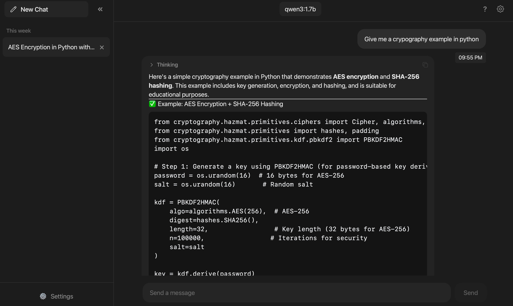

<p align="center">
  
</p>

# Chatlite

Tiny desktop chat UI for Ollama, built with Tauri + Preact.



## Why Chatlite

- Under **5 MB** app size
- Local, private and free (no telemetry, no bull)
- Support for password lock and encrypting chats
- Keyboard shortcuts for fast navigation
- Multiple themes
- Native desktop app (not Electron)

## Quick Start

Download the right build for your OS (macOS, Windows, or Linux) from the latest release:

https://github.com/that-one-arab/Chatlite/releases/latest

Or run from source:

```bash
bun install
bun run dev
```

Run the desktop app in development:

```bash
bun run tauri dev
```

Build release:

```bash
bun run build:release
```

Optional size check:

```bash
bun run measure-size
```

## Notes

- app size was measured on MacOS.
- On macOS, the app may be flagged as unsafe on first launch because the release is not signed/notarized with an Apple Developer ID, so Gatekeeper warns by default. If that happens, open `System Settings > Privacy & Security`, allow the app, then launch it again.
